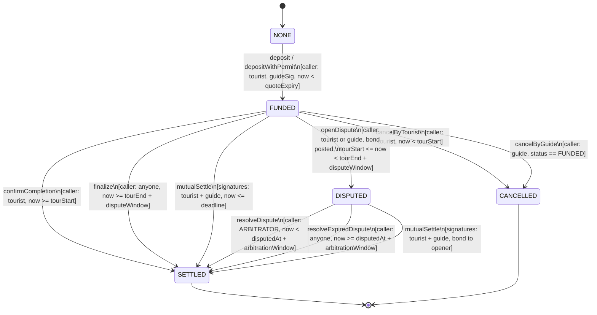

# GuideBloc (V3) State Machine Specification

## 1. Lifecycle Overview

A booking moves through a deterministic, non-reversible lifecycle governed strictly by immutable smart contract logic and complementary half-open timestamp intervals.



---

## 2. State Definitions

| Status | Code | Description | Permitted Next Actions |
|---|---|---|---|
| `NONE` | 0 | Unfunded quote / non-existent booking. | `deposit`, `depositWithPermit`, `cancelQuote` |
| `FUNDED` | 1 | Escrow funds locked. Active booking. | `confirmCompletion`, `finalize`, `cancelByTourist`, `cancelByGuide`, `openDispute`, `mutualSettle` |
| `DISPUTED` | 2 | Dispute active; bond locked. | `submitEvidence`, `resolveDispute`, `resolveExpiredDispute`, `mutualSettle` |
| `SETTLED` | 3 | **Terminal.** Escrow and bond distributed to `claimable`. | `withdraw`, `withdrawFor` |
| `CANCELLED` | 4 | **Terminal.** Funds returned / distributed to `claimable`. | `withdraw`, `withdrawFor` |

---

## 3. Strict Timing Boundaries

All time intervals are modeled as complementary half-open intervals to eliminate ambiguity at the exact second of transition:

```
                      tourStart               tourEnd        tourEnd + disputeWindow
                          |                      |                      |
[... Before tour ...] ----|--- Active Tour ------|-- Post-tour window --|--- Finalized --->
  cancelByTourist         |                                             |
  cancelByGuide           | <----------- openDispute Interval --------> | <--- finalize ---
                          |                                             |
```

1. **Tour Start (`tourStart`)**:
   - `now < tourStart`: `cancelByTourist` allowed. `confirmCompletion` and `openDispute` revert.
   - `now >= tourStart`: `confirmCompletion` and `openDispute` allowed. `cancelByTourist` reverts with `TourAlreadyStarted`.

2. **Dispute Window Boundary (`tourEnd + disputeWindow`)**:
   - `now < tourEnd + disputeWindow`: `openDispute` allowed. `finalize` reverts with `FinalizationTooEarly`.
   - `now >= tourEnd + disputeWindow`: `finalize` succeeds. `openDispute` reverts with `DisputeWindowClosed`.

3. **Arbitration Window Boundary (`disputedAt + arbitrationWindow`)**:
   - `now < disputedAt + arbitrationWindow`: `resolveDispute` allowed (Arbitrator). `resolveExpiredDispute` reverts with `ArbitrationWindowOpen`.
   - `now >= disputedAt + arbitrationWindow`: `resolveExpiredDispute` succeeds (Permissionless). `resolveDispute` reverts with `ArbitrationWindowClosed`.

4. **Refund Deadlines**:
   - `now < fullRefundDeadline`: Tier 1 (100% refund to tourist, 0% to guide, 0% commission).
   - `fullRefundDeadline <= now < partialRefundDeadline`: Tier 2 (`partialRefundBps` to tourist, remainder to guide minus commission).
   - `partialRefundDeadline <= now < tourStart`: Tier 3 (0% to tourist, 100% to guide minus commission).

---

## 4. Transition Rules & Financial Distribution

| Transition | Caller | Pre-conditions | Financial Distribution |
|---|---|---|---|
| `NONE -> FUNDED` | Tourist (`msg.sender == q.tourist`) | Valid guide EIP-712 signature, token allowlisted, `minAmount <= amount <= perBookingCap`, `totalLocked + amount <= tvlCap`, `now < quoteExpiry`. | Pulls `amount` from tourist into contract. Increases `totalLocked[token] += amount`. |
| `FUNDED -> SETTLED` (`confirmCompletion`) | Tourist | `now >= tourStart` | Guide gets `amount * (10000 - commissionBps) / 10000`. Treasury gets commission. Tourist gets 0. |
| `FUNDED -> SETTLED` (`finalize`) | Anyone | `now >= tourEnd + disputeWindow` | Guide gets `amount * (10000 - commissionBps) / 10000`. Treasury gets commission. Tourist gets 0. |
| `FUNDED -> SETTLED` (`mutualSettle`) | Anyone | Signatures from both tourist and guide. `now <= deadline`. | Tourist gets `amount * touristBps / 10000`. Guide gets remainder minus commission. Treasury gets commission on guide share. |
| `FUNDED -> CANCELLED` (`cancelByTourist`) | Tourist | `now < tourStart` | Tiered refund based on timestamp: Tier 1 (100%), Tier 2 (partial), Tier 3 (0%). |
| `FUNDED -> CANCELLED` (`cancelByGuide`) | Guide | `status == FUNDED` | 100% refund to tourist. 0% commission. |
| `FUNDED -> DISPUTED` (`openDispute`) | Tourist or Guide | `tourStart <= now < tourEnd + disputeWindow` | Pulls bond `max(10 USDC, amount * disputeBondBps / 10000)`. Status becomes `DISPUTED`. |
| `DISPUTED -> SETTLED` (`resolveDispute`) | `ARBITRATOR_ROLE` | `now < disputedAt + arbitrationWindow` | Custom split by arbitrator (`touristBps`). If opener receives > 50% of amount, bond returns to opener; otherwise bond awarded to counterparty. |
| `DISPUTED -> SETTLED` (`resolveExpiredDispute`) | Anyone | `now >= disputedAt + arbitrationWindow` | Default 50/50 split (`defaultDisputeTouristBps`). Bond returns to opener. |
| `DISPUTED -> SETTLED` (`mutualSettle`) | Anyone | Signatures from both parties. | Custom agreed split. Bond returns to opener. |
